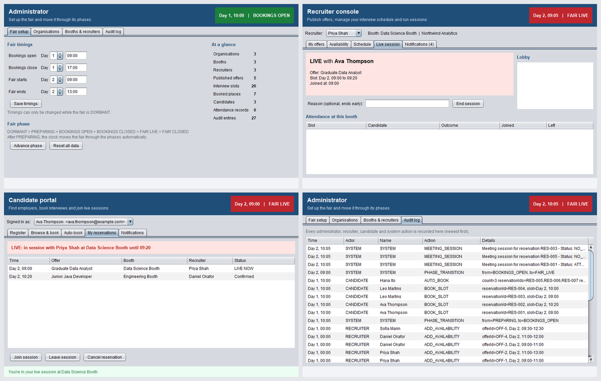
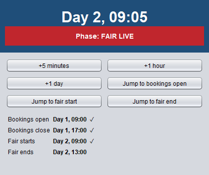
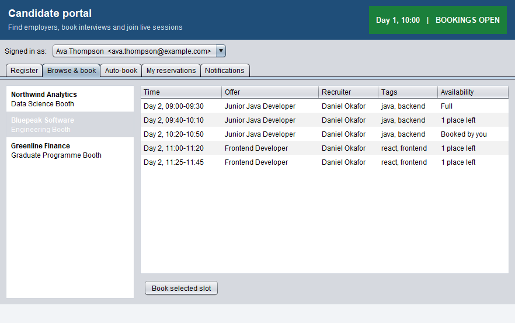
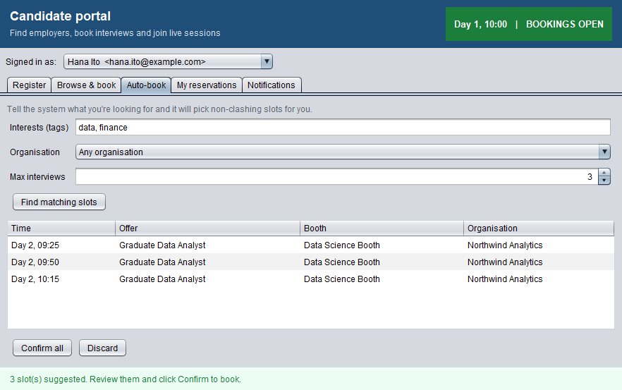
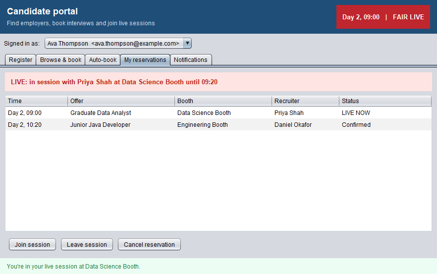
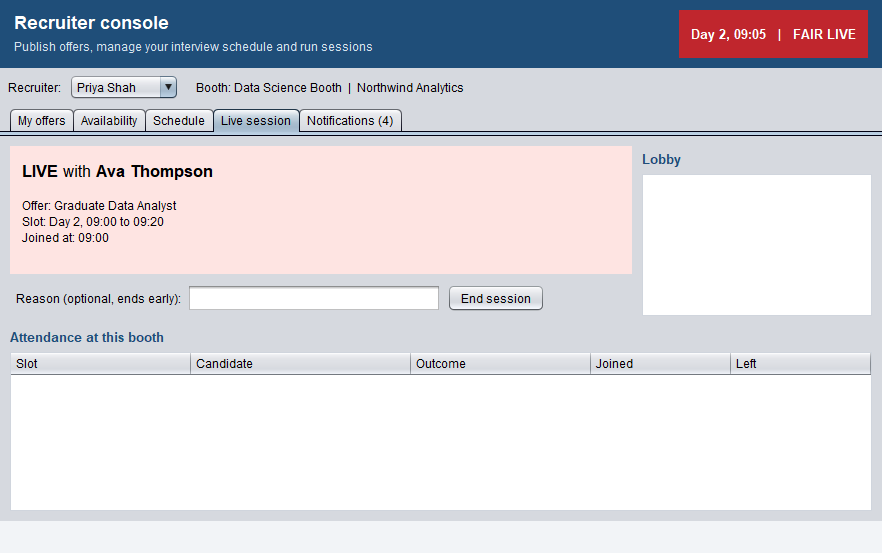
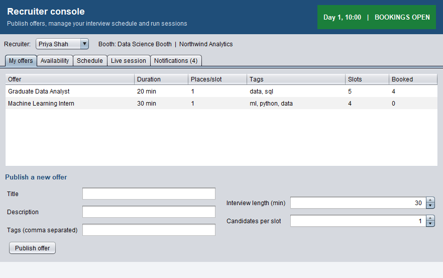
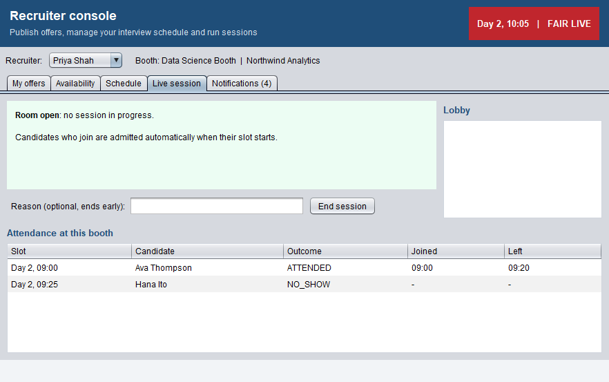
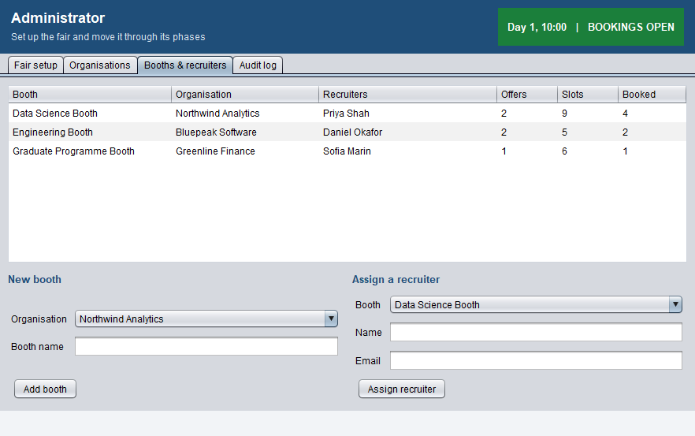
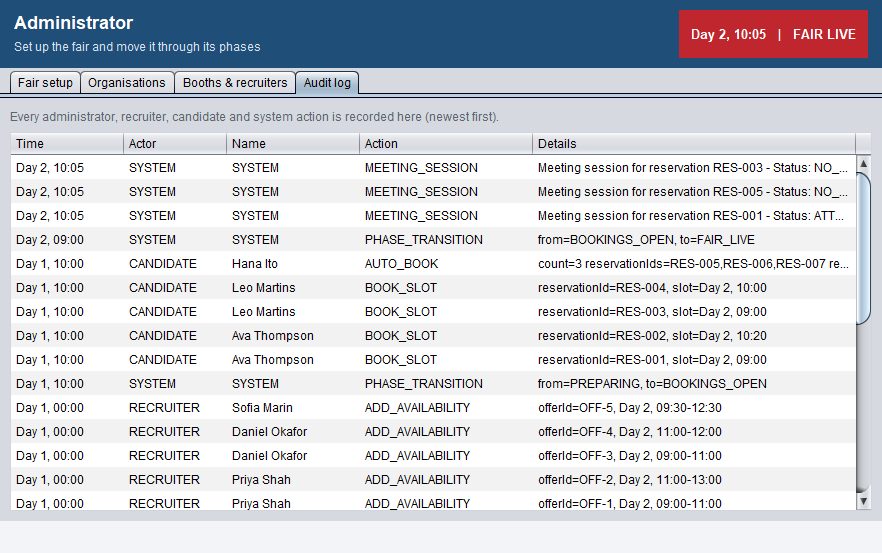

# Virtual Career Fair (Java Swing)

A desktop application that runs an online careers fair from start to finish. Administrators set the fair up, recruiters publish job offers and interview slots, and candidates book interviews (by hand or with automatic matching) and join live one-to-one sessions. A simulated clock moves the fair through its phases, and every action is written to an audit log.

It's built in plain Java with Swing, using the **Model-View-Controller** and **observer** patterns, and comes with **35 JUnit tests**.



## Features

### Administrator
- Configure the fair timings: when bookings open and close, and when the live fair starts and ends.
- Move the fair through its phases: `DORMANT → PREPARING → BOOKINGS OPEN → BOOKINGS CLOSED → FAIR LIVE → FAIR CLOSED`.
- Add organisations and booths, and assign recruiters to booths.
- View a live summary (offers, slots, bookings, attendance) and a full **audit log** of every action.

### Recruiter
- Publish job offers with an interview length, capacity and tags.
- Add availability windows, which are **split automatically into interview slots** with a buffer between them.
- See the interview schedule and cancel reservations (the candidate is notified).
- Run the **live session** at their booth: see who is in the session and who is waiting in the lobby, end a session early, and review attendance (attended, ended early, no-show).

### Candidate
- Register (duplicate emails are rejected) and browse booths and their open slots.
- Book slots manually. **Clash detection** stops overlapping bookings.
- **Auto-book**: enter interests (tags), a preferred organisation and a maximum number of interviews, and the system suggests non-clashing slots to confirm in one click.
- Join a session during the live fair: wait in the booth's **lobby**, then get admitted automatically when the slot starts.
- Receive notifications for bookings, cancellations and attendance outcomes.

### Simulation clock
Time is simulated, so the whole lifecycle can be demonstrated in minutes. Moving the clock forward changes the fair's phase automatically, starts and ends sessions at their slot times, and records candidates who never arrive as no-shows.

<p>
  
</p>

## Screenshots

| Browse booths and book a slot | Auto-book matching slots |
|---|---|
|  |  |

| Candidate in a live session | Recruiter's live session view |
|---|---|
|  |  |

| Recruiter offers | Attendance after the sessions |
|---|---|
|  |  |

| Admin: booths and recruiters | Admin: audit log |
|---|---|
|  |  |

## Architecture

```
            ┌──────────────── View (Swing) ────────────────┐
            │ AdminScreen  RecruiterScreen  CandidateScreen │  SystemTimerScreen
            └───────┬──────────────┬──────────────┬─────────┘          │
       user actions │              │              │                    │
            ┌───────▼──────────────▼──────────────▼─────────┐  ┌───────▼────────┐
            │ AdminController  RecruiterController           │  │ TimerController │
            │ CandidateController         (SubscriberInterface: update() ⇒ view.refresh())
            └───────┬───────────────────────────────────────┘  └───────┬────────┘
                    │ calls                                              │ advances
            ┌───────▼───────────────────────────────────────┐   ┌───────▼────────┐
            │ VCFSystem  (central model, notifies subscribers)│◄──│  SystemTime    │
            │  Organization ─ Booth ─ VirtualRoom ─ Lobby     │   │ (TimeObserver) │
            │  Recruiter ─ Offer ─ AvailabilityBlock ─ Slot   │   └────────────────┘
            │  Candidate ─ Reservation ─ MeetingSession       │
            │  AutoRequest  AuditEntry  AttendanceRecord      │
            └─────────────────────────────────────────────────┘
```

- **Model-View-Controller:** screens only display data and forward user actions; controllers call the model; the model holds all the business rules.
- **Observer pattern (twice):**
  - Controllers implement `SubscriberInterface` and are notified whenever `VCFSystem` changes, so a booking made in the candidate window appears in the recruiter and admin windows straight away.
  - `VCFSystem` is a `TimeObserver` of `SystemTime`. Every clock tick drives the phase changes, the lobby admissions and the session timeouts.
- **Business rules in the model**, for example:
  - Bookings are only allowed while bookings are open.
  - Slots respect their capacity, and candidates can't book clashing slots.
  - Cancellations free the slot and notify the other party.
  - Setup actions are only allowed in the right phase.
  - Every important action writes an audit entry.

## Tests

```
OK (35 tests)
```

| Test class | What it covers |
|------------|----------------|
| `LobbyTest` (8) | Lobby queue, duplicates, removal, admission when a slot starts |
| `MeetingSessionTest` (11) | Session start/end, early endings, no-shows, attendance records, audit entries |
| `ReservationTest` (7) | Confirming, double-booking protection, cancellations and notifications, clash detection |
| `VCFSystemTest` (9) | Slot generation, clock-driven phases, booking rules, duplicate registration, auto-booking, live sessions and no-shows, audit log |

## Getting started

You need **Java 17 or newer** (Java 21+ recommended). There are no other dependencies: JUnit and Hamcrest are in `lib/`.

```bash
git clone https://github.com/arslanahmedbhutto/virtual-career-fair-java.git
cd virtual-career-fair-java
./build.sh                       # Windows: build.bat
java -jar dist/virtual-career-fair.jar
```

The build script compiles the code, runs all tests and packages a runnable jar. The app opens four windows (Administrator, Recruiter, Candidate and Simulation clock) with a demo fair already set up:

1. **Bookings are open** (Day 1, 10:00). In the Candidate window, browse booths and book a slot, or try *Auto-book*.
2. In the clock window, click **Jump to fair start**. The fair goes live (Day 2, 09:00).
3. As *Ava Thompson*, open **My reservations**, select the 09:00 interview and click **Join session**. The recruiter window shows the live session.
4. Click **+1 hour**. Sessions end on their own, missed interviews become no-shows, and everything appears in the attendance table and the audit log.

Run `java -jar dist/virtual-career-fair.jar --empty` to start with a blank fair and set everything up yourself as the administrator.

## Project structure

```
virtual-career-fair-java/
├── src/
│   ├── Main.java          # Wires model, controllers and screens; starts the demo
│   ├── Model/             # Domain model and business rules (VCFSystem, Booth, Offer, Reservation, ...)
│   ├── Controller/        # One controller per role, each observing VCFSystem
│   └── View/              # Swing screens and shared UI helpers
├── test/                  # JUnit 4 tests
├── lib/                   # JUnit 4.13.2 and Hamcrest 1.3
├── screenshots/
├── build.sh / build.bat   # Compile, test and package
└── README.md
```

## Project history

This started as a **university team project**. The team designed the domain model (reservations, lobby, meeting sessions, auto-booking, audit log) and wrote the lobby and meeting-session tests. By the end of the course the GUI was still a prototype: the screens showed placeholder data, and the screens, controllers and model no longer fitted together, so the project didn't compile.

The integration was completed afterwards:
- **Fixed the build:** the code no longer compiled (38 errors), and an outdated duplicate model class was removed.
- **Finished the unimplemented model parts:** the simulation clock, the virtual room and live sessions, notifications, and availability blocks.
- **Added clock-driven behaviour:** phase changes, automatic lobby admission, session timeouts, no-shows and attendance records.
- **Fixed bugs:** auto-booking counted each slot twice, constructors ignored their arguments, and notifications crashed the app.
- **Wired the four screens to the real model** through the controllers, and added the demo data, build scripts and the new reservation and system tests.
